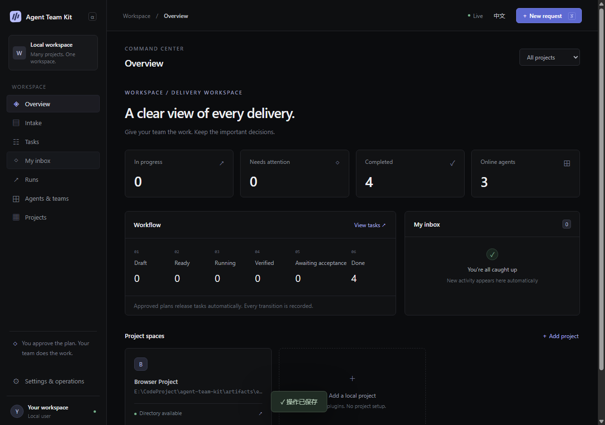

# Agent Team Kit

A local web workspace for coordinating external agents across multiple projects.

**2.0.0-alpha.1** is a breaking rebuild: no legacy task import, software plugins,
model adapters, model gateway, automatic agent launch, or worktrees.

## Run

Use Node.js 24. The release package contains the built web application and has
no production dependencies. It installs outside the projects it manages.

After a release has been published to npm (a GitHub source push does not publish it):

```sh
npm install -g agent-team-kit@next
atk start
# Open the private browserUrl printed by start (keep its access fragment private)
atk status
atk stop
```

For this source checkout:

```sh
corepack pnpm install --frozen-lockfile
node scripts/build-web.mjs
node apps/launcher/cli.mjs start
# To build/install your own independent release:
npm pack
npm install -g ./agent-team-kit-2.0.0-alpha.1.tgz
```

The new database defaults to `%LOCALAPPDATA%/AgentTeamKit/Next` on Windows.
Use `--data <directory>` to isolate an installation. Existing databases are not
loaded or upgraded. Register projects in the web UI; Git is optional.

## Workflow

1. Create a DRAFT request in the browser.
2. An external ORCHESTRATOR claims the planning stage and submits a versioned plan.
3. Approve that plan in the browser. WORKER tasks become eligible for claiming.
4. External agents claim authorized tasks, obtain cooperative file locks, renew
   leases and return structured evidence. Model access stays with those agents.
5. Optional independent REVIEWERs verify frozen candidates. Human tasks appear
   in My inbox. VERIFIED tasks unlock dependencies without individual approval.
6. Accept the final plan in the browser, bound to a checked output manifest.

Agents edit the registered project directly. Locks are released after stopped
execution and durable results, **before** review and final acceptance. A changed
candidate invalidates pending review/acceptance; expired leases quarantine locks
until the previous writer is confirmed stopped. Nothing automatically resets or
discards project edits.

## Agent connection



Create roles, teams and agent identities in the UI. Save the issued credential;
it is shown once. Agents can use HTTP or the package's machine CLI:

```sh
# Set ATK_AGENT_TOKEN securely in the external agent's environment.
atk-agent connect
atk-agent claim --wait 30000
atk-agent watch <runId> --generation <n>
atk-agent submit <runId> plan --file plan-receipt.json
# Or submit result / review for the other stages.
```

Run the lease watcher concurrently with your external execution. On loss of the
watcher, a stop request, or a lease error, stop writing. The watcher cannot kill
an external agent. Never put its credential into a repository or a receipt.

## Documentation and validation

- [中文说明](README.zh-CN.md)
- [Architecture and state rules](docs/ARCHITECTURE.md)
- [HTTP protocol, payloads and recovery](docs/AGENT-PROTOCOL.md)
- [Operations and backup/restore](docs/OPERATIONS.md)
- [Removed, retained and rebuilt modules](docs/REFACTOR.md)
- [Validation evidence and limitations](docs/VALIDATION.md)

```sh
node scripts/check-boundaries.mjs
node scripts/test.mjs
node scripts/build-web.mjs
node scripts/e2e.mjs
node scripts/smoke.mjs
node scripts/benchmark.mjs                 # full 30-minute soak
```

The browser checks require Chrome, Edge or Chromium. Set `ATK_BROWSER` for a
custom executable. CI runs the real workflow and an explicitly shorter 30-second
performance check; the full soak is reported separately. These tests use local
protocol clients, not AI models.

MIT license. Single user and loopback access only. File locks coordinate clients
that follow the protocol; they do not block editors or arbitrary processes.
