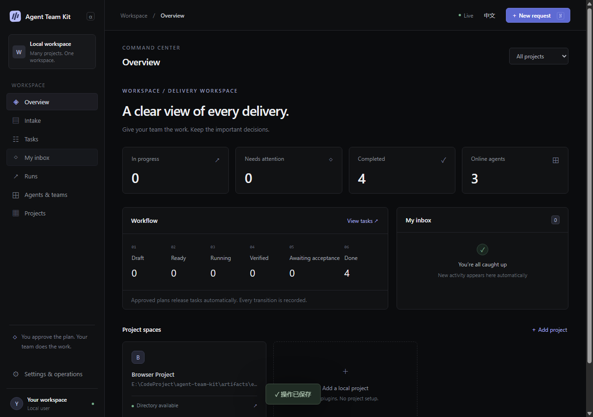

# Agent Team Kit

通过网页管理多个本地项目，由外部 Agent 主动领取任务的独立协作工具。

当前版本 **2.0.0-alpha.1**。这是一次不保留兼容层的重构：旧任务池、旧 CLI、DSH
插件、模型运行时和 worktree 流程均已退出生产代码。工具不配置模型、不转发请求，
不启动外部 Agent，也不会自动清理旧数据库或用户项目。

## 启动

**Windows x64 桌面开发版：双击根目录的 `dev.bat`。** 会直接打开 ATK 的独立窗口。
首次启动需要联网准备 Electron 和工作区依赖，便携工具放在本项目的 `artifacts/desktop-dev/`，
无需另装系统 Node.js，也无需先构建网页。后续启动复用已下载的依赖。

修改 React 组件和样式时由 Vite 热更新。保存后端源码、内置资源或共享后端包时，开发版会自动重载后端，桌面窗口和页面保持打开。若有任务、待确认停止的执行或自动化正在占用后端，重载会等到空闲。修改 Electron 主进程或启动配置后，仍需关闭窗口并重新运行 `dev.bat`。
桌面标题栏可切换或添加工作空间，也可拖动窗口，右侧有最小化、最大化／还原和关闭。
底栏左侧显示同步状态，右侧可切换语言和深浅主题；「设置与运维 → 外观」还可以选择跟随系统，主题选择会记住。
开发版关闭窗口即停止后台；有 Agent 正在执行时，请先结束或协调其停写再重启。
Agent 仍使用 `http://127.0.0.1:1421` 和原凭据。开发版沿用 `atk.local.json`、`ATK_DATA_DIR` 与现有默认数据目录；
若旧服务正在占用端口或数据目录，请先关闭它。可用 `ATK_PORT`、`ATK_DEV_PORT` 覆盖默认的 `1421`、`5173`。
本阶段不提供安装包，也不支持 macOS 开发启动脚本。

### 原有网页启动方式

需要 **Node.js 24**。发布包包含构建好的网页，没有生产依赖；安装位置与目标项目无关。

Windows 可直接双击根目录的 **start.bat**：启动后台服务并在默认浏览器中打开已解锁的网页；
重复启动会复用已有服务。双击 **stop.bat** 停止服务，关闭浏览器不会停止服务。
可以为这两个文件创建桌面快捷方式。源码首次使用前需要完成下方依赖安装及网页构建。

如需固定启动数据目录，可在启动文件旁创建仅本机保存的 `atk.local.json`：
`{"dataDir":"E:/AgentTeamKitData"}`。相对路径以启动文件所在目录为准；该文件不会提交到 Git。
不配置时使用下述默认目录。命令行 `--data` 优先于本机配置，`ATK_DATA_DIR` 也可覆盖本机配置。

以下 npm 安装方式适用于新版本正式发布后；本次 GitHub 源码提交不等于 npm 发布：

```powershell
npm install -g agent-team-kit@next
atk start
# 打开输出的私密 browserUrl 链接（含访问码，请勿分享）
atk status
atk stop
```

源码开发：

```powershell
corepack pnpm install --frozen-lockfile
node scripts/build-web.mjs
node apps/launcher/cli.mjs start
# 也可构建并安装独立发布包：
npm pack
npm install -g ./agent-team-kit-2.0.0-alpha.1.tgz
# 前后端可以分别启动；前端开发服务器为 http://127.0.0.1:5173
pnpm --filter @atk/web dev
```

新数据目录默认 `%LOCALAPPDATA%\AgentTeamKit\Next`，可通过 `--data <目录>` 覆盖。
在网页中注册已有项目目录即可；无需在项目里安装依赖、添加插件或初始化 Git。

## 使用流程

1. 人工新建需求，在「工作 → 任务」中进入 **预排（DRAFT）** 状态。
2. 外部 PM 身份以固定 **ORCHESTRATOR** 阶段领取，提交分工、依赖、文件范围和验收要求。
3. 人工批准具体计划版本后，一次性发布 **READY** 执行任务。
4. 外部 Agent 领取任务和文件锁，在项目目录执行，持续续租，回传检查结果和交付记录。
5. 按批准计划配置可选独立评审；中间任务 **VERIFIED** 后推进依赖，人工任务在“待我处理”完成。
6. 所有任务满足要求后，对整份计划统一人工验收。无需每个中间任务反复点确认。

「工作」的二级侧栏包含「待我处理」「任务」「Bug 单」「执行记录」。任务默认使用看板，可按流程或执行方分组，也可以切回列表。
按流程分组时，「预排」和「待开始」分别占一列。需求、人工任务和 Agent 任务共用同一个看板；
人工任务依赖满足后可在卡片上开始或提交交付。对已批准、尚未执行或已停止的 Agent 任务，
可以从卡片或任务详情指定同团队、符合角色的具体 Agent，也可以恢复为由符合角色的 Agent 领取。
指派不会启动进程；指定的 Agent 仍需主动领取，并满足依赖、并发和文件锁条件。

任务页工具栏的「显示」可切换看板、列表、表格和泳道。泳道按执行方横向分区，各区共享流程列。
可以调整排序方向、隐藏子任务，以及选择看板或泳道中的列与卡片属性。设置按工作空间保存在浏览器中。

在任务详情的「日期和标签」里可设置、修改或清除截止日期和标签。在「显示」里可选择卡片是否展示这两个字段；
任务页的「筛选」支持指定日期、今天、未来七天、已逾期或没有截止日期，并可和标签组合筛选。
这些字段用于整理任务，不影响领取或审批。

PM 不能执行或评审自己规划的任务；WORKER 不能自审；Agent 凭据不能代替人工批准。

在「工作 → Bug 单」填写标题和复现描述，选择当前小队的修复角色。Bug 单无需规划，创建后直接待修复；
对应角色的 Agent 可照常领取，也可用 `atk-agent claim --kind bug --wait 30000` 只领 Bug 单。
修复提交后，用户可从「待我处理」验收：通过即关闭，退回时填写原因，下次领取会附上这条反馈。
报单时可缩小文件范围；留空则使用修复角色允许的范围。

## 文件锁与交付

- 同文件、父目录和子文件的写入冲突会等待；不同文件可以并行。
- 执行结束并确认停止、快照与回执持久化后即释放锁，不等待评审和验收。
- 失联只会将锁标为异常占用；需要确认旧执行停止后才能释放。
- 评审或验收目标变化会失效；已验证任务的合法后继修改保留历史记录。
- 修改直接发生在项目目录，失败、停止和取消不会自动回滚代码。
- 这是协议层的协作锁，不能阻止编辑器和不遵守协议的进程写入文件。

全局 SQLite 保存权威状态。项目资料默认写入各自 `.agent-team/`，包括计划、
执行前后快照、检查证据和验收记录。资料生成失败会显示在网页并可重试。

## 外部 Agent



打开「Agent 团队」，在左侧二级侧栏切换全部 Agent、当前工作空间的小队 Agent 和本机成员；
点击 Agent 卡片上的「角色模板」，在弹窗中查看和编辑它绑定的模板；在「小队」新建角色、配置角色组成与并发。
「资源」下的 Agent 模板、Skills、MCP 和 CLI 共用 ATK 数据目录中的 `resources/`。
可以在网页新建，也可以复制资源文件夹进去。外部 Agent 领取任务后可用
`atk-agent resources list` 发现资源。目录约定和调用方式见[团队资源](docs/TEAM-RESOURCES.md)。
创建 Agent 身份后，保存只展示一次的凭据。接入时通过外部环境
变量 `ATK_AGENT_TOKEN` 提供凭据，`ATK_URL` 默认为 `http://127.0.0.1:1421`。

```powershell
atk-agent doctor
atk-agent connect
atk-agent claim --wait 30000
atk-agent watch <runId> --generation <n>
atk-agent submit <runId> plan --file plan-receipt.json
atk-agent submit <runId> result --file result-receipt.json
atk-agent submit <runId> review --file review-receipt.json
```

`doctor` 只验证本地服务与凭据；`connect` 才登记联系。网页的 Agent 接入面板会显示最近联系时间。
就绪任务的详情可以查看领取诊断；任务与执行面板均可复制本机链接，打开时仍需解锁工作空间。

`watch` 与实际执行同时运行，只维护租约，不会启动或终止 AI。出现 `STOP REQUIRED`、
续租失败或停止请求时，外部执行端必须停止写入。模型和登录由外部 Agent 自己管理。

## 文档与验证

- [架构与状态机](docs/ARCHITECTURE.md)
- [自动化流程、日志和自定义进度](docs/AUTOMATIONS.md)
- [完整 Agent 协议及样例](docs/AGENT-PROTOCOL.md)
- [启动、备份、恢复](docs/OPERATIONS.md)
- [模块处置及阶段验收](docs/REFACTOR.md)
- [测试证据、性能及边界](docs/VALIDATION.md)

网页采用 Linear 风格，支持中英双语、列表与看板、计划审批、人工待办、实时事件、
交付差异和多项目切换。第一版限定本机单用户，不提供远程执行或模型网关。
